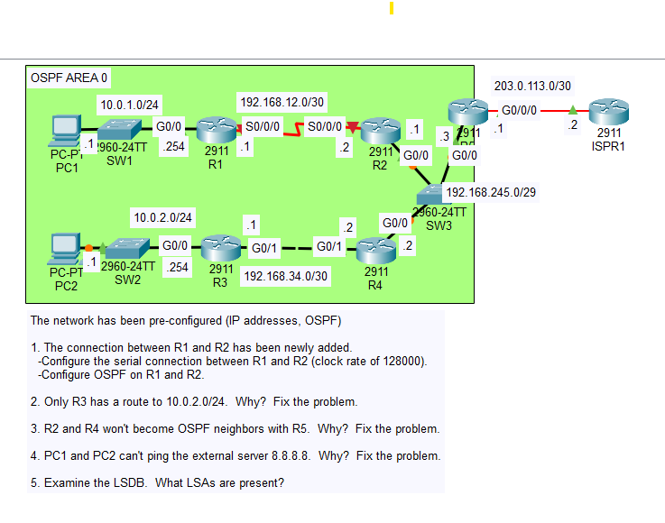

# OSPF Lab: Troubleshooting (Part 3)
## Topology


This lab was about troubleshooting a single-area OSPF network. I went through five tasks, covering:

- Serial link clocking (DCE/DTE)
- OSPF network type mismatch
- Hello and dead timer mismatch
- Default route origination
- Verifying the OSPF database (LSDB)

## Task 1

R1 Serial 0 is DCE → Sets The clockrate

R2 Serial 0 is DTE

## Task 2

Problem is in the link between R3 and R4, R3 G0/1 is a point-to-point type, and R4 G0/1 is broadcast type. For an Ethernet connection broadcast is the default but the problem is the mismatch between the two interfaces.

```text
     10.0.0.0/24 is subnetted, 2 subnets
O       10.0.1.0/24 [110/66] via 192.168.245.1, 00:13:14, GigabitEthernet0/0
O       10.0.2.0/24 [110/2] via 192.168.34.1, 00:00:03, GigabitEthernet0/1
     192.168.12.0/30 is subnetted, 1 subnets
O       192.168.12.0/30 [110/65] via 192.168.245.1, 00:14:14, GigabitEthernet0/0
     192.168.34.0/24 is variably subnetted, 2 subnets, 2 masks
C       192.168.34.0/30 is directly connected, GigabitEthernet0/1
L       192.168.34.2/32 is directly connected, GigabitEthernet0/1
     192.168.245.0/24 is variably subnetted, 2 subnets, 2 masks
C       192.168.245.0/29 is directly connected, GigabitEthernet0/0
L       192.168.245.2/32 is directly connected, GigabitEthernet0/0
```

## Task 3

The problem is at R5's G0/0 interface. The dead and hello timers were modified while on the rest of the routers the default values remain. They should be matching.

```text
R5#sh ip ospf int g0/0

GigabitEthernet0/0 is up, line protocol is up
  Timer intervals configured, Hello 5, Dead 20, Wait 20, Retransmit 5
```

```text
R2(config)#do sh ip ospf int g0/0

GigabitEthernet0/0 is up, line protocol is up
  Timer intervals configured, Hello 10, Dead 40, Wait 40, Retransmit 5
```

## Task 4

The problem was that R5 was advertising its default route but none was configured. After configuring this PC1 was able to ping 8.8.8.8 external router.

```text
C:\>ping 8.8.8.8

Pinging 8.8.8.8 with 32 bytes of data:

Request timed out.
Reply from 8.8.8.8: bytes=32 time=1ms TTL=252
Reply from 8.8.8.8: bytes=32 time=1ms TTL=252
Reply from 8.8.8.8: bytes=32 time=12ms TTL=252

Ping statistics for 8.8.8.8:
    Packets: Sent = 4, Received = 3, Lost = 1 (25% loss),
Approximate round trip times in milli-seconds:
    Minimum = 1ms, Maximum = 12ms, Average = 4ms
```

## Task 5

R1 LSDB:

```text
R1(config-if)#do sh ip ospf datab
            OSPF Router with ID (192.168.12.1) (Process ID 1)

                Router Link States (Area 0)

Link ID         ADV Router      Age         Seq#       Checksum Link count
192.168.12.1    192.168.12.1    1529        0x80000003 0x00f081 3
192.168.34.1    192.168.34.1    740         0x80000007 0x00ee10 2
192.168.245.2   192.168.245.2   347         0x80000007 0x00603d 2
203.0.113.1     203.0.113.1     347         0x80000003 0x008689 1
192.168.245.1   192.168.245.1   347         0x80000006 0x004a83 3

                Net Link States (Area 0)
Link ID         ADV Router      Age         Seq#       Checksum
192.168.34.2    192.168.245.2   1600        0x80000002 0x00d24d
192.168.245.3   203.0.113.1     347         0x80000002 0x00307b

                Type-5 AS External Link States
Link ID         ADV Router      Age         Seq#       Checksum Tag
0.0.0.0         203.0.113.1     108         0x80000001 0x00d2c1 1   ----> Default Route LSA
```

> Lab file from Jeremy's IT Lab's Free CCNA Course.