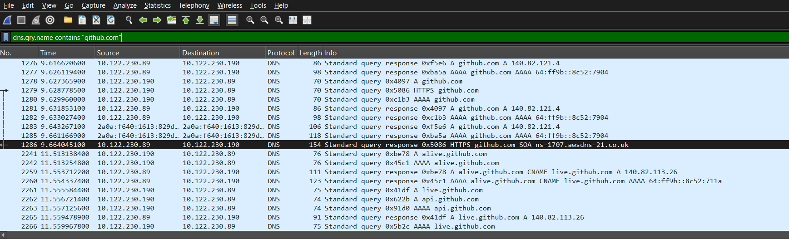
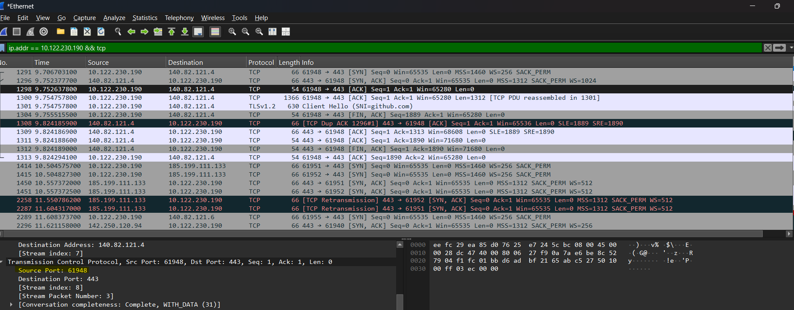
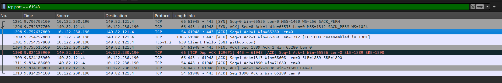

# Capturing TCP Handshakes with Wireshark

## Objective

Capture live network traffic with Wireshark, then identify and analyze a TCP
**three-way handshake** (connection establishment) and a TCP **four-way
handshake** (connection termination) in a real connection.

## Method

**1. Find the site's IP via DNS**

```
dns.qry.name == "github.com"
```



**2. Filter the traffic to that server**

```
ip.addr == 10.122.230.190
```

**3. Isolate a single TCP connection**

```
tcp.port == 61948
```



## Findings

### TCP three-way handshake (connection establishment)

Packets 1291, 1296, 1298

| No. | Direction | Flags | Seq / Ack (relative) | Notes |
|-----|-----------|-------|----------------------|-------|
| 1291 | Client → Server | SYN | Seq=0 | window scale 256 |
| 1296 | Server → Client | SYN, ACK | Seq=0, Ack=1 | Server accepts |
| 1298 | Client → Server | ACK | Seq=1, Ack=1 | Connection established |

### TCP four-way handshake (connection termination)

Packets 1304, 1311, 1312, 1313

| No. | Direction | Flags | Seq / Ack (relative) | Notes |
|-----|-----------|-------|----------------------|-------|
| 1304 | Client → Server | FIN, ACK | Seq=1889, Ack=1 | Client begins closing its side |
| 1311 | Server → Client | ACK | Seq=1, Ack=1890 | Server acknowledges the FIN (1889 + 1) |
| 1312 | Server → Client | FIN, ACK | Seq=1, Ack=1890 | Server closes its side |
| 1313 | Client → Server | ACK | Seq=1890, Ack=2 | Final ACK, connection fully closed |

> Task list from Jeremy's IT Lab's Free CCNA Course.

​
