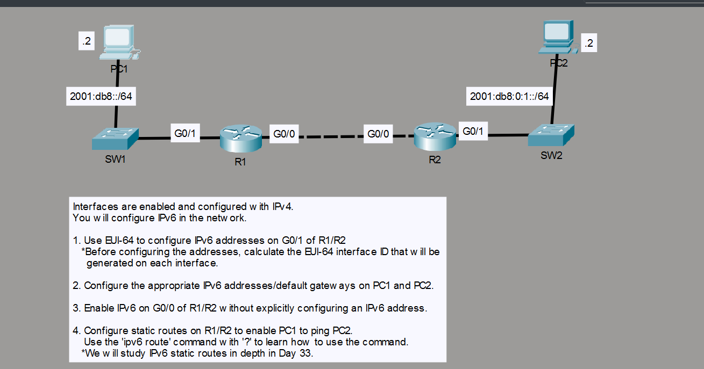
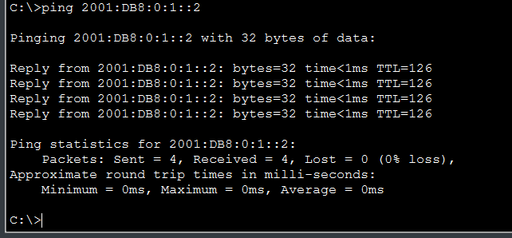

# Day 32 - IPv6 Configuration (Part 2)

Lab from Jeremy's IT Lab's free CCNA course. The IPv4 side of the network was already configured, so my job was to add IPv6 on top of it: EUI-64 addresses, host configuration, link-local only interfaces and static routes between the two routers.

## Topology



| Device | Interface | IPv6 | IPv4 |
|--------|-----------|------|------|
| R1 | G0/0 | link-local only (`ipv6 enable`) | 192.168.1.1/30 |
| R1 | G0/1 | `2001:db8::/64` EUI-64 | 10.0.1.254/24 |
| R2 | G0/0 | link-local only (`ipv6 enable`) | 192.168.1.2/30 |
| R2 | G0/1 | `2001:db8:0:1::/64` EUI-64 | 10.0.2.254/24 |
| PC1 | NIC | `2001:db8::2/64` | |
| PC2 | NIC | `2001:db8:0:1::2/64` | |

## What I did

### 1. EUI-64 addresses on G0/1 of R1 and R2

I have already had loads of manual calculation practice so I just let the router calculate the EUI-64 addresses.

```
R1(config)# interface g0/1
R1(config-if)# ipv6 address 2001:db8::/64 eui-64

R2(config)# interface g0/1
R2(config-if)# ipv6 address 2001:db8:0:1::/64 eui-64
```

### 2. IPv6 addresses and default gateways on the PCs

- PC1: `2001:db8::2/64`, default gateway = R1 G0/1
- PC2: `2001:db8:0:1::2/64`, default gateway = R2 G0/1

The gateway is the router's address on that LAN.

### 3. Enable IPv6 on G0/0 without an explicit address

```
R1(config)# interface g0/0
R1(config-if)# ipv6 enable

R2(config)# interface g0/0
R2(config-if)# ipv6 enable
```

`ipv6 enable` gives the interface a link-local address (`FE80::/10`, built with EUI-64) without configuring a global unicast address. That is enough for the point-to-point link, because the routers only need to reach each other's link-local address as the next hop.

### 4. Static routes so PC1 can ping PC2

`ipv6 unicast-routing` has to be enabled globally, otherwise the router will not forward IPv6 packets. Each router needs a route to the other side's LAN, using the neighbor's **link-local** address as next hop:

```
R1(config)# ipv6 unicast-routing
R1(config)# ipv6 route 2001:db8:0:1::/64 g0/0 FE80::201:63FF:FEB0:B801

R2(config)# ipv6 unicast-routing
R2(config)# ipv6 route 2001:db8::/64 g0/0 FE80::230:F2FF:FE36:4501
```

When the next hop is a link-local address, the **exit interface must be specified** too. A link-local address is only unique on one link, so the router has no way to know which interface it belongs to otherwise.

## Verification

```
show ipv6 interface brief
show ipv6 route
ping 2001:db8:0:1::2     (from PC1)
```



## What I learned

- `ipv6 unicast-routing` is not on by default, and without it a router does not route IPv6.
- Static routes with a link-local next hop need an exit interface as well.

### IPv6 will be continued in the next lesson. Which I will also include in this repo.

> Lab file from Jeremy's IT Lab's Free CCNA Course.