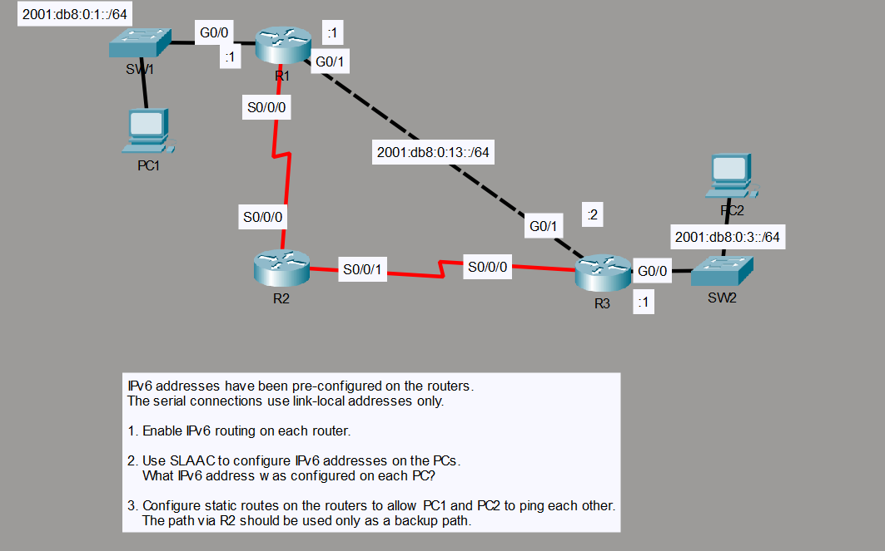

# IPv6 Lab: SLAAC, Static Routes and Floating Static Routes



This was the final part of the dedicated IPv6 lessons. This was very interesting to me and I learnt a lot.

In this lab I tested SLAAC IPv6 address generation and configured static routes so that the PCs could ping each other.
I also set up a backup route through serial interfaces, which were using link-local addresses.

## Mistakes I Made

1. **Wrong exit interface on the backup routes.** When configuring the backup routes, I set the exit interface as the next-hop router's interface instead of the interface on the local router.
2. **Missing AD on the floating static route.** When configuring the floating static route on Router 1, I forgot to set the AD higher and it started load balancing between the two routes. Therefore, every second ping was lost. (The other side was set correctly, therefore from R2 to R3 there was no route.)

### Defective Ping Result

```
C:\>ping 2001:DB8:0:1:20A:41FF:FE4D:1BBC

Pinging 2001:DB8:0:1:20A:41FF:FE4D:1BBC with 32 bytes of data:

Reply from 2001:DB8:0:1:20A:41FF:FE4D:1BBC: bytes=32 time<1ms TTL=126
Request timed out.
Reply from 2001:DB8:0:1:20A:41FF:FE4D:1BBC: bytes=32 time<1ms TTL=126
Request timed out.

Ping statistics for 2001:DB8:0:1:20A:41FF:FE4D:1BBC:
    Packets: Sent = 4, Received = 2, Lost = 2 (50% loss),
Approximate round trip times in milli-seconds:
    Minimum = 0ms, Maximum = 0ms, Average = 0ms
```

## Routing Tables

Here are the routing tables of the routers I configured static routes on.
The backup routes can't be seen here because they will only be added when the main static routes go down.
Though the routes on R2 can be seen (which belong to the backup path).

### R1 Routes

```
C   2001:DB8:0:1::/64 [0/0]
     via GigabitEthernet0/0, directly connected
L   2001:DB8:0:1::1/128 [0/0]
     via GigabitEthernet0/0, receive
S   2001:DB8:0:3::/64 [1/0]
     via 2001:DB8:0:13::2
C   2001:DB8:0:13::/64 [0/0]
     via GigabitEthernet0/1, directly connected
L   2001:DB8:0:13::1/128 [0/0]
     via GigabitEthernet0/1, receive
L   FF00::/8 [0/0]
     via Null0, receive
```

### R3 Routes

```
S   2001:DB8:0:1::/64 [1/0]
     via 2001:DB8:0:13::1
C   2001:DB8:0:3::/64 [0/0]
     via GigabitEthernet0/0, directly connected
L   2001:DB8:0:3::1/128 [0/0]
     via GigabitEthernet0/0, receive
C   2001:DB8:0:13::/64 [0/0]
     via GigabitEthernet0/1, directly connected
L   2001:DB8:0:13::2/128 [0/0]
     via GigabitEthernet0/1, receive
L   FF00::/8 [0/0]
     via Null0, receive
```

### R2 Routes

```
S   2001:DB8:0:1::/64 [1/0]
     via FE80::202:4AFF:FE23:E201, Serial0/0/0
S   2001:DB8:0:3::/64 [1/0]
     via FE80::290:2BFF:FECC:A101, Serial0/0/0
L   FF00::/8 [0/0]
     via Null0, receive
```

## R3 Routing Table with the Gigabit Ethernet Interface Down

Here's the routing table of R3 when the Gigabit Ethernet interface is down.

```
S   2001:DB8:0:1::/64 [100/0]
     via FE80::20B:BEFF:FED7:4901, Serial0/0/0
C   2001:DB8:0:3::/64 [0/0]
     via GigabitEthernet0/0, directly connected
L   2001:DB8:0:3::1/128 [0/0]
     via GigabitEthernet0/0, receive
L   FF00::/8 [0/0]
     via Null0, receive
```

As you can see, the static route through the serial interface is added.

---

> Lab file from Jeremy's IT Lab's Free CCNA Course.